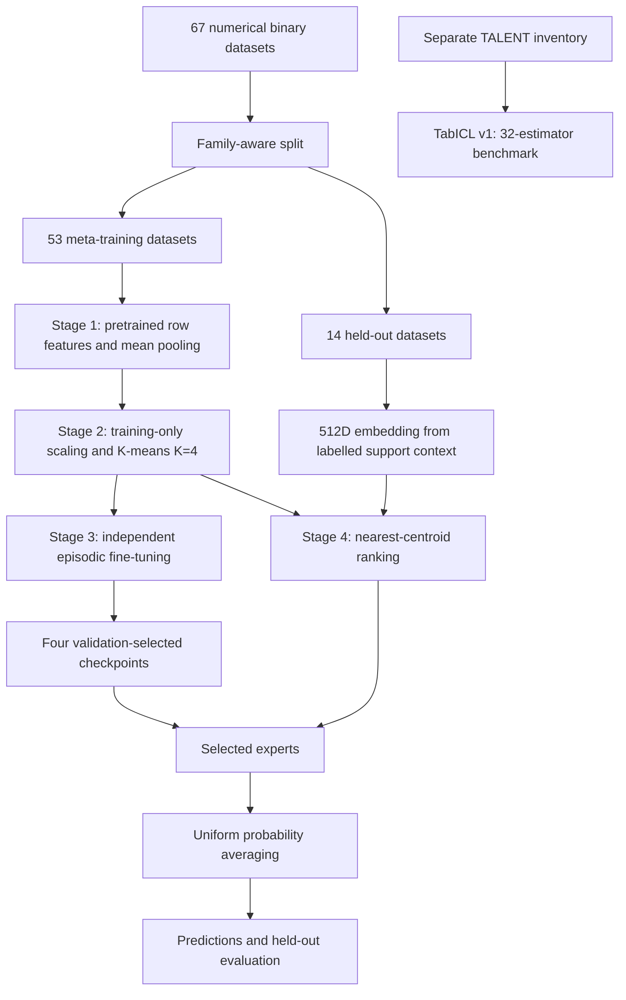
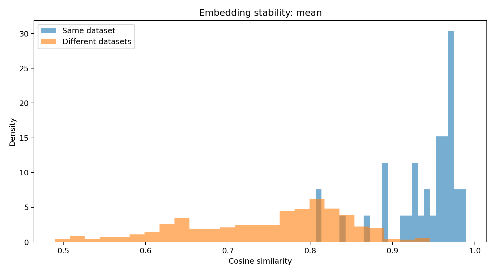
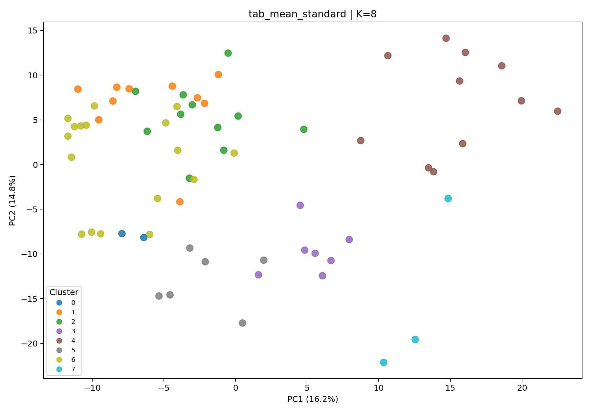

# Dataset-Specialised TabICL

**MA 305 — Data Science Project | End Evaluation | Team 7**

[](report/MA305_Report_Team7.pdf)
[](requirements.txt)
[](https://github.com/soda-inria/tabicl)
[](results/talent_benchmark/TabICL_TALENT_Report.pdf)

Dataset-level representation learning, cluster-based expert specialisation and retrieval-based prediction for tabular classification, with an independent large-scale evaluation of pretrained TabICL on TALENT.

[Read the final report](report/MA305_Report_Team7.pdf) · [Browse results](results/) · [Open benchmarking notebook](talent_benchmarking/TabICL_TALENT_200_Colab.ipynb) · [Reproduce experiments](#reproduction)

## Table of contents

- [Project overview](#project-overview)
- [Architecture](#architecture)
- [Repository structure](#repository-structure)
- [Stage 1 — Dataset representation](#stage-1--dataset-representation)
- [Stage 2 — Dataset clustering](#stage-2--dataset-clustering)
- [Stage 3 — Expert training](#stage-3--expert-training)
- [Stage 4 — Expert routing](#stage-4--expert-routing)
- [Specialist experiment results](#specialist-experiment-results)
- [TALENT benchmarking](#talent-benchmarking)
- [Reproduction](#reproduction)
- [Report and artifacts](#report-and-artifacts)
- [Limitations and future work](#limitations-and-future-work)
- [Team](#team)
- [References and acknowledgements](#references-and-acknowledgements)

## Project overview

TabICL is a pretrained tabular in-context learning model. Our research asks whether dataset-level similarity can guide the selection of independently fine-tuned experts, rather than relying on a single generalist for every task.

| Component | Experimental scope |
| --- | --- |
| Dataset representations | 67 numerical-only binary classification datasets |
| Final specialist configuration | 512D mean embeddings, K-means with K=4 |
| Meta-training / meta-testing | 53 / 14 datasets, family-aware split |
| Expert optimisation | Four independent runs, 90 steps each |
| Independent TALENT benchmark | 188 of 200 tasks completed, TabICL v1 |

**Main finding:** nearest Top-3 reaches 86.33% mean accuracy versus 86.16% for pretrained v2. Fixed Top-3 reaches 86.38%; the pretrained baseline remains best on balanced accuracy, macro F1 and log loss. The prototype demonstrates feasibility, not a reliable routing advantage.

## Architecture



The TALENT benchmark is a separate experiment, not a training stage or a matched comparison against the specialists.

[Back to contents](#table-of-contents)

## Repository structure

| Directory | Contents |
| --- | --- |
| [`dataset_representation_and_clustering/`](dataset_representation_and_clustering/) | Statistical and learned embeddings, stability, clustering and exploratory plots |
| [`expert_training_and_routing/`](expert_training_and_routing/) | Frozen manifest, embedding regeneration, router, training and inference |
| [`talent_benchmarking/`](talent_benchmarking/) | Independent v1 Colab notebook and instructions |
| [`results/`](results/) | Validation histories, per-dataset metrics, routing selections and benchmark summaries |
| [`report/`](report/) | Final IEEE manuscript, PDF and figures |
| [`requirements.txt`](requirements.txt) | Recorded specialist environment |
| [`tabicl_upstream_commit.txt`](tabicl_upstream_commit.txt) | Pinned upstream v2 code revision |

## Stage 1 — Dataset representation

Three representations were explored: 88D statistical meta-features, 512D mean-pooled pretrained TabICL row features and 1024D mean-plus-standard-deviation pooling. Mean pooling was selected for the final pipeline.

| Representation | Within-dataset cosine | Between-dataset cosine | Gap | NN matches |
| --- | ---: | ---: | ---: | ---: |
| Mean (512D) | 0.938 | 0.747 | 0.191 | 33/36 |
| Mean + std (1024D) | 0.945 | 0.792 | 0.153 | 32/36 |

Stability was measured on 12 datasets with three samples of 128 rows each. The final embedding extractor uses 256 labelled context rows and excludes an additional unlabelled probe row from pooling.

<p align="center"></p>

**Code:** [Statistical meta-features](dataset_representation_and_clustering/strategy_3_1.py) · [TabICL embeddings](dataset_representation_and_clustering/strategy_3_2.py) · [Stability experiment](dataset_representation_and_clustering/test_embedding_stability.py) · [Final extractor](expert_training_and_routing/extract_embeddings.py)

## Stage 2 — Dataset clustering

Exploratory K=8 experiments produced some very small groups. K=4 was selected for practical training feasibility rather than demonstrated predictive superiority.. The final router fits a variance mask, standard scaler and ordinary K-means on the 53 meta-training embeddings only. All 53 original cluster assignments were reproduced.

| Cluster | Assigned datasets | Expert training | Expert validation |
| --- | ---: | ---: | ---: |
| 0 | 16 | 13 | 3 |
| 1 | 15 | 11 | 4 |
| 2 | 12 | 9 | 3 |
| 3 | 10 | 9 | 1 |
| Total | 53 | 42 | 11 |

<p align="center"></p>
<p align="center"><em>Exploratory K=8 PCA projection, not the final K=4 partition.</em></p>

**Code and data:** [Clustering comparisons](dataset_representation_and_clustering/compare_representations.py) · [Family-aware K=4 split](dataset_representation_and_clustering/prepare_routing_k4.py) · [Final router](expert_training_and_routing/build_router.py) · [Frozen manifest](expert_training_and_routing/routing_manifest.csv)

## Stage 3 — Expert training

Each expert starts from the same pretrained TabICL v2 checkpoint. The column embedder and row interactor are frozen, while the ICL predictor is fine-tuned (26,276,362 trainable parameters per expert). Each update samples one dataset from the expert's training group and constructs a labelled context/query episode. Cross-entropy is optimised using AdamW; the best validation checkpoint is retained, including the pretrained initialization as a candidate.

| Setting | Value |
| --- | --- |
| GPU | RTX 3050 Laptop, 6 GB |
| Epochs × updates | 3 × 30 per expert |
| Episode rows / feature cap | 64 / 32 |
| Query fraction | 0.25 |
| Learning rate / weight decay | 1e-5 / 0.01 |
| Base seed | 42 |

| Expert | Initial validation loss | Epoch 1 | Epoch 2 | Epoch 3 | Selected |
| --- | ---: | ---: | ---: | ---: | --- |
| 0 | .3707 | .3322 | .3298 | **.3266** | Epoch 3 |
| 1 | .3587 | .3092 | **.2921** | .3030 | Epoch 2 |
| 2 | **.1772** | .2013 | .1846 | .1884 | Pretrained |
| 3 | .7525 | .7283 | **.6568** | .6740 | Epoch 2 |

All four runs completed 90 training steps. Only three selected checkpoints contain fine-tuned weights.

**Code:** [Training loop](expert_training_and_routing/train_experts.py) · [Shared data utilities](expert_training_and_routing/common.py) · [Training histories](results/)

## Stage 4 — Expert routing

For a new dataset, the pretrained representation extractor generates a 512D embedding, then the saved training-fitted mask and scaler transform it. Experts are ranked by **Euclidean distance** to the fitted centroids, not cosine similarity. Top-1 uses the nearest expert; Top-3 averages aligned class probabilities uniformly. Random and fixed expert selection serve as diagnostic controls.

**Code:** [Inference evaluator](expert_training_and_routing/evaluate.py) · [Routing ablations](expert_training_and_routing/evaluate_routing_ablation.py)

[Back to contents](#table-of-contents)

## Specialist experiment results

Mean per-dataset metrics over all 14 held-out tasks (256 support and 128 query rows from source training arrays; one estimator per model).

| Method | Accuracy | Balanced accuracy | Macro F1 | Log loss ↓ |
| --- | ---: | ---: | ---: | ---: |
| Pretrained v2 | 86.16% | **82.39%** | **82.02%** | **0.28946** |
| Nearest Top-1 | 85.71% | 80.79% | 80.76% | 0.29900 |
| Nearest Top-3 | 86.33% | 81.76% | 81.44% | 0.29054 |
| Random Top-1 | 86.22% | 82.15% | 81.54% | 0.29314 |
| Random Top-3 | 86.22% | 81.12% | 80.92% | 0.29056 |
| Fixed Top-1 | 86.22% | 81.15% | 81.04% | 0.29795 |
| Fixed Top-3 | **86.38%** | 81.88% | 81.64% | 0.29105 |

**Raw summaries:** [Main evaluation](results/evaluation/summary.json) · [Per-dataset CSV](results/evaluation/per_dataset.csv) · [Nearest](results/ablation_nearest/) · [Random](results/ablation_random/) · [Fixed](results/ablation_fixed/)

Nearest Top-3 improves accuracy by 0.17 percentage points but not the other metrics. The fixed ensemble was chosen after initial routing inspection, and no significance test was conducted.

## TALENT benchmarking

A separate evaluation of pretrained **TabICL v1** uses 32 estimators, seed 42, official full train/test partitions, Tesla T4 GPU and AMP disabled. No specialist fine-tuning is performed.

| Subset | Tasks | Accuracy | Macro OvR AUC | Log loss | Median runtime |
| --- | ---: | ---: | ---: | ---: | ---: |
| All completed | 188 | 83.48% | 0.8936 | 0.3796 | 12.57 s |
| Binary | 117 | 85.11% | 0.8732 | 0.3153 | 12.72 s |
| Multiclass | 71 | 80.79% | 0.9272 | 0.4856 | 11.92 s |

Coverage is 94%. The workbook contains 187 scored tasks; the later report also includes `philippine`. Raw JSON records for the 188-task run are not supplied. Pending tasks are excluded from reported means. Runtime covers fit and probability prediction only; the mean is 79.41 s.

[Benchmark notebook](talent_benchmarking/TabICL_TALENT_200_Colab.ipynb) · [Colab instructions](talent_benchmarking/README.md) · [Benchmark report and plots](results/talent_benchmark/TabICL_TALENT_Report.pdf) · [Excel metrics](results/talent_benchmark/TALENT_200.xlsx)

**Do not compare 83.48% and 86.33% as a specialist improvement:** model versions, dataset inventory, evaluation partitions, context size and estimator count differ.

[Back to contents](#table-of-contents)

## Reproduction

### Environment and data

Run from the repository root, using Python 3.10 and a CUDA-capable GPU for specialist training. The requirements file records the original environment, not a universally portable lockfile. Install a matching PyTorch CUDA wheel from its appropriate package index if necessary. The v2 trainer depends on internal APIs; use the recorded upstream revision.

```bash
git clone https://github.com/Mahidhar21/Dataset-Specialised-TabICL.git
cd Dataset-Specialised-TabICL
python -m venv .venv
source .venv/bin/activate
python -m pip install -r requirements.txt
python -m pip install matplotlib
python -m pip install "tabicl[finetune] @ git+https://github.com/soda-inria/tabicl.git@$(cat tabicl_upstream_commit.txt)"
export DATA=/absolute/path/to/dataset-250115/data
```

Obtain the original numerical dataset arrays separately. Dataset subfolders must match the committed manifest and contain `N_train.npy` and `y_train.npy`; exploratory scripts may require additional metadata. See the [original dataset documentation](dataset_representation_and_clustering/ReadMe.md).

### Exploratory representations and clustering

Run in a separate checkout if you want to retain the committed exploratory artifacts unchanged.

```bash
python dataset_representation_and_clustering/strategy_3_1.py
python dataset_representation_and_clustering/strategy_3_2.py
python dataset_representation_and_clustering/test_embedding_stability.py
python dataset_representation_and_clustering/compare_representations.py
python dataset_representation_and_clustering/prepare_routing_experiment.py
python dataset_representation_and_clustering/prepare_routing_k4.py
```

### Final v2 pipeline

```bash
python -m expert_training_and_routing.extract_embeddings --data-dir "$DATA" --device cpu
python -m expert_training_and_routing.build_router
```

Do not bypass cluster-assignment mismatches. Train four experts independently:

```bash
for i in 0 1 2 3; do
  python -m expert_training_and_routing.train_experts \
    --data-dir "$DATA" --expert "$i" --epochs 3 \
    --steps-per-epoch 30 --rows 64 --features 32 || break
done
```

After all four runs complete, evaluate and perform ablations:

```bash
python -m expert_training_and_routing.evaluate \
  --data-dir "$DATA" --max-datasets 0 --top-k 3

for mode in nearest random fixed; do
  python -m expert_training_and_routing.evaluate_routing_ablation \
    --data-dir "$DATA" --routing "$mode" --seed 42 --top-k 3 \
    --fixed-experts 0,1,2 --output "outputs/stage32/ablation_$mode" || break
done
```

Generated embeddings, router and model checkpoints are excluded from Git; regenerate them or use the saved baseline archive. After repository consolidation, syntax checks, five module help commands and a two-dataset inference smoke test with existing checkpoints passed. Full retraining was not repeated after restructuring.

### Independent v1 notebook

Open the [TALENT notebook](talent_benchmarking/TabICL_TALENT_200_Colab.ipynb) in Google Colab, enable a GPU runtime and authorise Drive access. Follow the [notebook README](talent_benchmarking/README.md). Its pinned v1 environment is separate from the v2 environment above. Use a fresh output directory when changing configurations; completed tasks are skipped on resume.

## Report and artifacts

- [Final MA 305 report (PDF)](report/MA305_Report_Team7.pdf)
- [Editable IEEE LaTeX source](report/main.tex) and [figures](report/figures/)
- [Specialist experiment outputs](results/)
- [Original embedding and clustering artifacts](dataset_representation_and_clustering/representations/)
- [TALENT metrics workbook and benchmark report](results/talent_benchmark/)

To compile the paper, upload `report/main.tex` together with `report/figures/` to Overleaf, or run `latexmk -pdf main.tex` from the report directory with a suitable TeX installation.

## Limitations and future work

- Only one specialist split and seed were evaluated; five held-out tasks belong to one microwave dataset family.
- Full source-array median imputation precedes support/query splitting; the embedding hook also sees an extra unlabelled probe row. Strict support-only preprocessing is future work.
- Expert 2 retains pretrained weights; cluster similarity does not necessarily reflect expert competence. The Top-3 ensembles overlap substantially with only four experts.
- TALENT results describe completed tasks only; completion bias, absent raw predictions and absence of matched comparative runs limit conclusions.
- Future directions: expert competence matrix and oracle routing diagnostics, independent meta-validation, global fine-tuning baseline, repeated family-aware splits and matched v1/v2 benchmarks.

## Team

**Team 7 — MA 305 Data Science Project, End Evaluation**

| Team member | Roll number |
| --- | --- |
| Ayinala Sri Nikesh | 240041005 |
| Geddada Mahidhar | 240041017 |
| Kesavarapu Deepak Reddy | 240041022 |

## References and acknowledgements

- Qu, J., Holzmüller, D., Varoquaux, G., and Le Morvan, M. *TabICL: A Tabular Foundation Model for In-Context Learning on Large Data*. ICML, 2025. [Upstream implementation](https://github.com/soda-inria/tabicl).
- [Central team repository](https://github.com/Mahidhar21/Dataset-Specialised-TabICL).
- [Earlier specialist implementation and results](https://github.com/sri-nikesh-31/Dataset-Specialised-TabICL).
- [Team TALENT experimental report](results/talent_benchmark/TabICL_TALENT_Report.pdf).

Original contributor attribution and upstream licenses should be retained. See the consolidated report for the full bibliography.

[Back to top](#dataset-specialised-tabicl)
